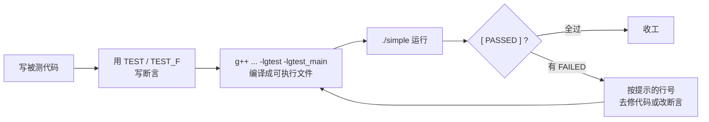

# gtest 入门教程（零基础版）

本文以本目录的 `simple.cc` 为例，从「什么是测试」讲起，一行行说清楚。

---

## 0. 先说人话：gtest 是干啥的？

你写了个函数 `Add(a, b)`，想知道它算得对不对。**土办法**是自己写个 `main`：

```cpp
int main() {
    if (Add(1, 2) != 3) std::cout << "错了！" << std::endl;
}
```

函数一多，这种代码就写不完，而且只能手工盯着看。

**gtest 的办法**是：把「我以为应该是什么结果」写成一句话，让它自动跑、自动对比、自动告诉你哪条没过：

```cpp
TEST(AddTest, Basic) {
    EXPECT_EQ(Add(1, 2), 3);   // 我期望 Add(1,2) 等于 3
}
```

跑起来是这样的（绿色代表通过）：

```
[ RUN      ] AddTest.Basic
[       OK ] AddTest.Basic (0 ms)
```

**说人话就是：gtest 帮你把「自己手动试一遍」变成机器自动试。**

---

## 1. 装好 gtest

Ubuntu / Debian：

```bash
sudo apt-get install libgtest-dev        # 头文件
sudo apt-get install googletest          # 已经编译好的库（新版系统一般有这个包）
```

检查一下（两个都存在就 OK）：

```bash
ls /usr/include/gtest/gtest.h
ls /usr/lib/x86_64-linux-gnu/libgtest_main.a
```

---

## 2. 最小例子：三行就够

```cpp
#include <gtest/gtest.h>   // ← 用 gtest 必须先包这个头文件

int Add(int a, int b) {    // 被测的函数
    return a + b;
}

TEST(AddTest, Basic)       // 定义一个测试用例
{
    EXPECT_EQ(Add(1, 2), 3);   // 期望 Add(1,2) == 3
}
```

三件事要注意：

1. **`TEST` 的两个名字必须用英文**：`TEST(测试套件名, 用例名)`，像 `TEST(AddTest, Basic)`。
   这个名字会显示在输出里，起得好一眼就知道哪挂了。
2. **不用写 `main` 函数**。链接 `-lgtest_main` 就会自动给你一个（见第 6 节）。
3. **断言就是一个宏**：`EXPECT_EQ(实际值, 期望值)`。

---

## 3. 常用断言：把「应该怎样」写出来

### 比大小 / 比相等

| 宏 | 含义 | 例子 |
| --- | --- | --- |
| `EXPECT_EQ(a, b)` | 相等（`==`） | `EXPECT_EQ(Add(1,2), 3)` |
| `EXPECT_NE(a, b)` | 不相等（`!=`） | `EXPECT_NE(Add(1,1), 3)` |
| `EXPECT_GT(a, b)` | 大于（`>`） | `EXPECT_GT(Add(10,20), 20)` |
| `EXPECT_LT(a, b)` | 小于（`<`） | `EXPECT_LT(Add(1,1), 5)` |
| `EXPECT_GE(a, b)` | 大于等于（`>=`） | `EXPECT_GE(x, 0)` |
| `EXPECT_LE(a, b)` | 小于等于（`<=`） | `EXPECT_LE(x, 100)` |

### 真假 / 空 / 指针

```cpp
EXPECT_TRUE(flag);            // 为真
EXPECT_FALSE(ptr == nullptr); // 为假
```

### 浮点数（**千万别直接用 EXPECT_EQ**）

`0.1 + 0.2` 在计算机里不等于 `0.3`，所以要用「允许误差」的比较：

```cpp
EXPECT_NEAR(Divide(1.0, 3.0), 0.3333, 1e-4);   // 相差在 1e-4 以内就算过
EXPECT_DOUBLE_EQ(Divide(10.0, 4.0), 2.5);
```

### 字符串

```cpp
EXPECT_STREQ(s.c_str(), "Hello, world");   // C 风格字符串（char*）比较内容
EXPECT_EQ(str, "Hello, bob");              // std::string 直接用 == 就行
```

### 异常

```cpp
EXPECT_THROW(Divide(1.0, 0.0), std::runtime_error);   // 必须抛出这个异常
EXPECT_NO_THROW(Divide(1.0, 1.0));                    // 必须不抛异常
```

### `EXPECT_` 和 `ASSERT_` 的区别（很重要）

- `EXPECT_xxx` 失败 → 打印错误，**继续往下跑**，最后统一汇报。**默认都用这个。**
- `ASSERT_xxx` 失败 → **当场结束这个用例**。只在「后面依赖前面成立」时才用，比如先 `ASSERT_FALSE(v.empty())` 再去取 `v.front()`。

---

## 4. 一个套件里写多个用例

用例越多越好，每个只测一件事，名字写清楚：

```cpp
TEST(AddTest, Basic) {
    EXPECT_EQ(Add(1, 2), 3);
    EXPECT_EQ(Add(-1, 1), 0);
}

TEST(AddTest, Compare) {
    EXPECT_GT(Add(10, 20), 20);
    EXPECT_NE(Add(1, 1), 3);
}
```

`AddTest` 是**测试套件**（一组相关的用例），`Basic` / `Compare` 是**用例**。输出里会写成 `AddTest.Basic`。

---

## 5. 测试夹具 TEST_F：多个用例要共用准备代码

比如两个用例都要先准备一个 `[1, 2]` 的数组。复制粘贴太丑，用**夹具**：

```cpp
class VectorTest : public ::testing::Test {
protected:
    void SetUp() override {          // 每个用例开始前自动调用
        v_.push_back(1);
        v_.push_back(2);
    }

    void TearDown() override {       // 每个用例结束后自动调用
        v_.clear();
    }

    std::vector<int> v_;             // 在 SetUp 里准备，在用例里直接用
};

TEST_F(VectorTest, SizeIsTwo) {      // 注意是 TEST_F，不是 TEST
    EXPECT_EQ(v_.size(), 2u);
}

TEST_F(VectorTest, FirstIsOne) {
    ASSERT_FALSE(v_.empty());
    EXPECT_EQ(v_.front(), 1);
}
```

**三个要点：**

1. 类必须继承 `::testing::Test`，而且**类名就是 `TEST_F` 的第一个参数**。
2. 用 `TEST_F`（F = Fixture 夹具），不是 `TEST`。
3. 每个用例跑之前都会 `SetUp`、跑完都会 `TearDown`，所以用例之间**互不影响**。

---

## 6. 编译

### 方式一：命令行

```bash
g++ -Wall -std=c++14 simple.cc -o simple -lgtest -lgtest_main -lpthread
```

- `-lgtest` → gtest 本体
- `-lgtest_main` → 自带的 `main()`，这样你就不用自己写了
- `-lpthread` → 少了这个可能在老系统上链接失败

### 方式二：Makefile（本目录已有）

```makefile
CXXFLAGS = -Wall -std=c++14
LDFLAGS  = -lgtest -lgtest_main -lpthread

simple : simple.cc
	$(CXX) $(CXXFLAGS) simple.cc -o simple $(LDFLAGS)

test : simple
	./simple

.PHONY : clean test
clean :
	rm -f simple
```

用起来：

```bash
make        # 编译
make test   # 编译 + 运行
make clean  # 删掉产物
```

### 如果你自己想写 `main`

不链接 `-lgtest_main`，改成自己写：

```cpp
int main(int argc, char** argv) {
    ::testing::InitGoogleTest(&argc, argv);   // 处理 --gtest_xxx 参数
    return RUN_ALL_TESTS();                   // 跑所有用例并返回结果
}
```

---

## 7. 运行结果怎么看

```bash
$ ./simple
Running main() from ./googletest/src/gtest_main.cc
[==========] Running 7 tests from 4 test suites.
[----------] Global test environment set-up.
[----------] 2 tests from AddTest
[ RUN      ] AddTest.Basic
[       OK ] AddTest.Basic (0 ms)
[ RUN      ] AddTest.Compare
[       OK ] AddTest.Compare (0 ms)
[----------] 2 tests from AddTest (0 ms total)
...
[----------] Global test environment tear-down
[==========] 7 tests from 4 test suites ran. (0 ms total)
[  PASSED  ] 7 tests.
```

逐行读：

| 输出 | 意思 |
| --- | --- |
| `Running main() from ...` | 用的是 `gtest_main` 自带的主函数，正常现象 |
| `Running 7 tests from 4 test suites` | 一共 7 个用例、4 个套件 |
| `[ RUN ] AddTest.Basic` | 开始跑某个用例 |
| `[ OK ] ... (0 ms)` | 通过，括号里是耗时 |
| `[ PASSED ] 7 tests.` | **全部通过**，看这一行就够 |

有失败时会变成这样，直接告诉你哪个值不对：

```
[  FAILED  ] AddTest.Basic
  simple.cc:47: Failure
  Expected equality of these values:
    Add(1, 2)
      Which is: 4
    3
[  FAILED  ] 1 test, listed below:
[  FAILED  ] AddTest.Basic
```

最后进程返回码非 0，所以能直接用在学校/CI 的自动化流程里。

---

## 8. 常用的运行参数（不用改代码）

| 命令 | 作用 |
| --- | --- |
| `./simple` | 跑全部用例 |
| `./simple --gtest_filter=AddTest.*` | 只跑 `AddTest` 套件下的所有用例 |
| `./simple --gtest_filter=AddTest.Basic` | 只跑一个用例 |
| `./simple --gtest_filter=-AddTest.*` | **减号是排除**，除了 AddTest 都跑 |
| `./simple --gtest_list_tests` | 只列出用例名，不执行 |
| `./simple --gtest_repeat=3` | 重复跑 3 遍（查随机性问题很好用） |
| `./simple --gtest_shuffle` | 打乱顺序跑 |
| `./simple --gtest_break_on_failure` | 失败时直接断点，方便用 gdb 调试 |

真实效果（只列用例不执行）：

```
$ ./simple --gtest_list_tests
AddTest.
  Basic
  Compare
DivideTest.
  Normal
  Throw
...
```

---

## 9. 报错 / 卡住了怎么办

| 现象 | 原因 / 解决 |
| --- | --- |
| `TEST` 那行报语法错误 | 两个名字之间是**逗号**，名字不能有引号、空格、中文 |
| `undefined reference to main` | 忘了加 `-lgtest_main`，或自己写 `main` |
| `undefined reference to testing::...` | 忘了加 `-lgtest` |
| `#include <gtest/gtest.h>` 找不到文件 | 没装 `libgtest-dev` |
| 断言里的值类型不匹配编译报错 | `EXPECT_EQ` 的两个参数类型要能比较，`size_t` 对比 `int` 会被警告，写成 `2u` |
| `EXPECT_EQ(0.3, 0.1+0.2)` 挂了 | 浮点数不能用 `==`，换 `EXPECT_NEAR` |
| 某个用例挂了但看不到原因 | 加 `--gtest_break_on_failure` 用 gdb 跟进去 |

---

## 10. 一页速查表

| 想做的事 | 怎么写 |
| --- | --- |
| 写一个用例 | `TEST(套件名, 用例名) { ... }` |
| 用例要共用准备代码 | 继承 `::testing::Test` + `TEST_F` |
| 断言相等 | `EXPECT_EQ(actual, expect)` |
| 断言浮点相等 | `EXPECT_NEAR(a, b, 误差)` |
| 断言抛异常 | `EXPECT_THROW(语句, 异常类型)` |
| 让程序能跑 | 链接 `-lgtest -lgtest_main -lpthread` |
| 只跑一部分 | `--gtest_filter=套件名.*` |

**整体流程：**


